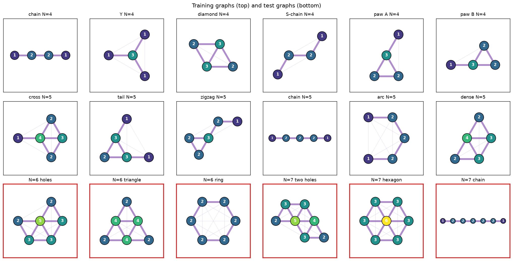
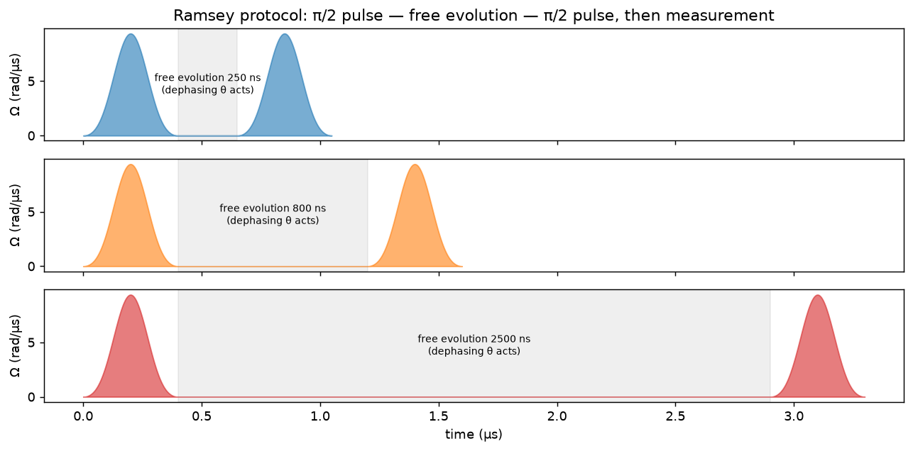
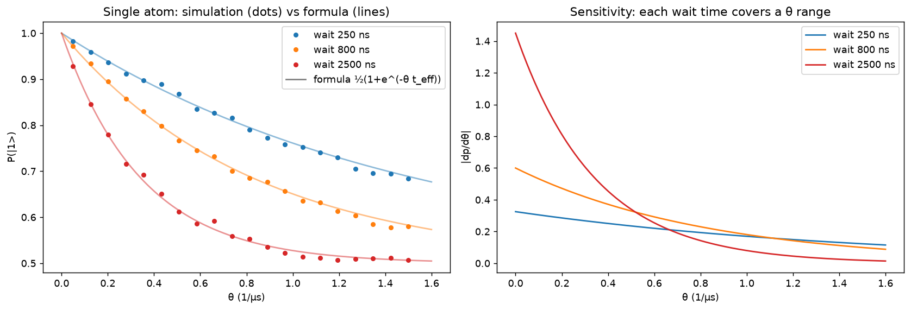
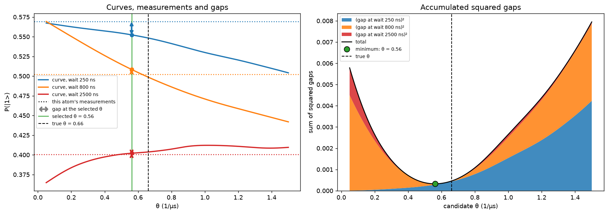
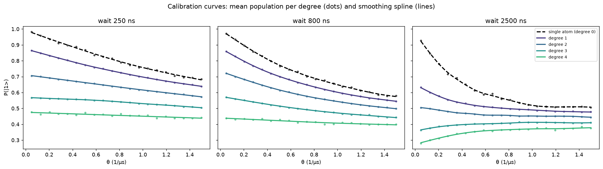
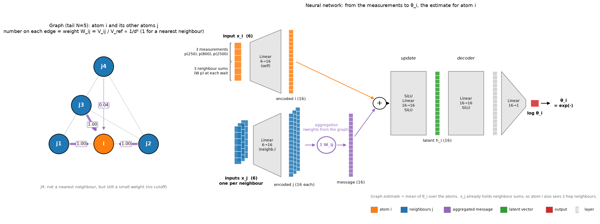
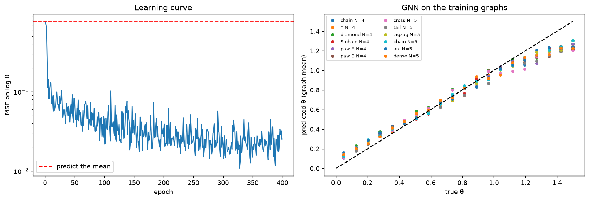
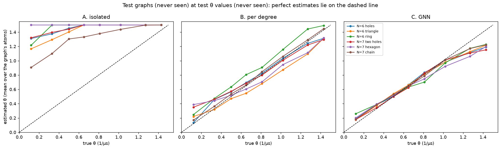
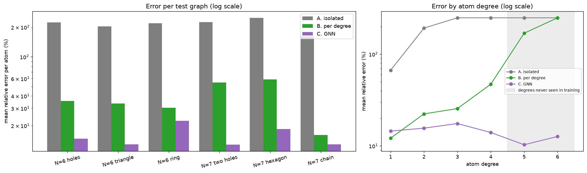

# Estimating a dephasing rate on graphs larger than those we can simulate

## Context

Neutral-atom registers lose coherence through **dephasing**, at a rate θ that is usually unknown. Estimating θ from measurements is a prerequisite for calibrating or correcting it.

To develop and test an estimator, we need data where θ is known. That data comes from simulation, and simulating dephasing is an open-system (Lindblad) calculation whose cost grows exponentially with the number of atoms. Measured on this machine, one simulation takes about **0.14 s for 5 atoms, 0.5 s for 6 atoms and 2.2 s for 7 atoms**, a factor of roughly 4 per added atom. We therefore stay on **small graphs** (4–5 atoms for training, 6–7 atoms for testing).

**The question.** Real registers are larger than anything we can simulate with dephasing. Can an estimator built on small graphs be **extrapolated to larger, differently shaped graphs** and still give useful estimates?

**The approach.** We compare two kinds of estimator, all trained only on 4–5 atom graphs and evaluated on unseen 6–7 atom graphs, at unseen θ values:

- **Baseline estimators (A and B):** a calibration curve, i.e. the average measurement as a function of θ, inverted to read θ off a measurement. This is the standard approach.
- **A message-passing neural network (C):** it also receives the measurements and couplings of each atom's neighbours.

**Result.** The mean relative error per atom on the test graphs is:

| Estimator | Uses | Mean relative error [95 % interval] |
|---|---|---|
| A. Single-atom curve | the measurements only | 213 % [136, 304] |
| B. One curve per degree | the measurements and the atom's degree | 39 % [26, 55] |
| C. Message-passing network | the measurements and the neighbourhood | **15.6 %** [10.3, 21.9] |

The intervals are bootstrap intervals over the 48 test simulations. Over 5 training seeds, the network's error is 11.6 % on average, with a standard deviation of 2.5 % (§4).

---

## 1. The experiment

### Atoms on a triangular lattice

Atoms sit on sites of a triangular lattice with spacing 9 µm. Every pair of atoms interacts through the van der Waals coupling

$$V_{ij} = \frac{C_6}{d_{ij}^6}$$

applied to **all pairs**, with no cutoff. Nearest neighbours couple at V_ref ≈ 10.2 rad/µs; next-nearest neighbours (15.6 µm) at V_ref / 27 ≈ 0.38 rad/µs.

The **degree** of an atom is its number of nearest neighbours.



*Training graphs (top, 12 graphs of 4–5 atoms) and test graphs (bottom, red frame, 6 graphs of 6–7 atoms). The number in each atom is its degree. Line width is the coupling V_ij relative to V_ref. Training graphs contain degrees 1 to 4 only; test graphs contain atoms of degree 5 (N=6 holes, N=7 two holes) and 6 (N=7 hexagon), which never appear in training. The 7-atom chain and the 6-atom ring have only degree 1–2 atoms but a size or shape not seen in training.*

### Ramsey protocol

Every atom receives the same global laser sequence: a π/2 pulse, a free evolution of fixed duration (the **wait**), a second π/2 pulse, then a measurement of each atom (|0⟩ or |1⟩).



Without noise, the two π/2 pulses add up to a π pulse and an isolated atom always ends in |1⟩. Dephasing during the wait lowers P(|1⟩). Each experiment is repeated 5000 times (shots), giving P(|1⟩) for every atom. We use **three wait times**: 250, 800 and 2500 ns.

### Data

- **Training θ:** 20 values from 0.05 to 1.50 µs⁻¹.
- **Test θ:** 8 values that are **not** on the training grid.
- **Table:** every (graph, θ, wait) combination is simulated once (Pulser + QuTiP) and stored in `data/simulations.parquet`, one row per (graph, θ, atom): 1412 rows in total.

---

## 2. Calibration-curve estimators (A and B)

### A single atom

For an isolated atom, the simulation matches the analytic Ramsey formula

$$p(\theta, t) = \tfrac12\left(1 + e^{-\theta\, t_\text{eff}}\right), \qquad t_\text{eff} = \text{wait} + 400\ \text{ns}$$

The residual between simulation and formula has an RMS of 0.0066, the same as the shot noise alone (0.0065 at p = 0.7).



The shot noise on a measured P(|1⟩) is √(p(1−p)/5000), about 0.007. Dividing it by the slope |dp/dθ| gives the **θ resolution** of one measurement, i.e. the θ error caused by shot noise alone:

| θ | wait 250 ns | wait 800 ns | wait 2500 ns |
|---|---|---|---|
| 0.2 | 0.012 | 0.009 | **0.007** |
| 0.6 | 0.024 | **0.021** | 0.027 |
| 1.0 | **0.036** | 0.037 | 0.088 |
| 1.4 | **0.049** | 0.062 | 0.283 |

The best wait time depends on θ: the longest wait is the most precise at small θ, the shortest at large θ. At θ = 1.4, the 2500 ns measurement is 6 times less precise than the 250 ns one. Using several wait times covers the whole θ range.

### Selecting θ from three curves

A **calibration curve** gives the mean P(|1⟩) of a chosen set of atoms as a function of θ, for one wait time. We fit it as a smoothing spline (`scipy.interpolate.make_smoothing_spline`) on the training data. The smoothing level is set automatically by generalised cross-validation, and each point is weighted by √(number of atoms averaged).

To estimate θ for one atom, we compare its three measurements (one per wait) with the three curves. We pick the θ for which the curves are, **together, closest to the measurements**, i.e. the θ minimising

$$\sum_{\text{waits}} \big(\text{curve}_\text{wait}(\theta) - p_\text{wait}\big)^2$$



*One degree-3 atom with true θ = 0.66. Left: the three calibration curves (degree-3 atoms, solid) and this atom's three measurements (dotted). At the selected θ = 0.56, the double arrows are the gaps between each curve and its measurement. Right: the squared gaps, stacked and in the same colours, as a function of the candidate θ. Their total has a minimum at the selected θ.*

The wait times are known inputs, and θ is the only unknown. Each measurement gives one constraint, and the least-squares choice satisfies all three as well as possible. The search is restricted to the training range [0.05, 1.50].

### A versus B: whether the degree is used

The two baseline estimators differ only in **which atoms the calibration curves are fitted on**:

- **A ignores the degree.** One set of three curves, fitted on the single-atom rows (degree 0), is used for every atom, whatever its number of neighbours.
- **B uses the degree.** One set of three curves per degree, each fitted on the training atoms of that degree. To estimate θ for an atom, B uses the curves of that atom's degree. For a degree never seen in training (5 or 6), it uses the closest known degree, which is 4.

### Why ignoring the degree matters

The curves differ strongly between degrees:



*Mean P(|1⟩) versus θ for each degree (dots) and the fitted spline (lines), one panel per wait time. Training data only.*

**Effect of the number of neighbours.** Mean P(|1⟩) per degree on the training rows, and the least-squares change per additional neighbour (degrees 0–4):

| Wait | degree 0 | degree 1 | degree 2 | degree 3 | degree 4 | change per neighbour (95 % CI) |
|---|---|---|---|---|---|---|
| 250 ns | 0.812 | 0.738 | 0.638 | 0.540 | 0.456 | −0.096 ± 0.004 |
| 800 ns | 0.724 | 0.662 | 0.586 | 0.495 | 0.415 | −0.082 ± 0.005 |
| 2500 ns | 0.607 | 0.516 | 0.463 | 0.401 | 0.353 | −0.058 ± 0.002 |

At 250 ns, one extra neighbour lowers P(|1⟩) by 0.096 (±0.004). For comparison, sweeping θ over its whole range (0.05 to 1.50 µs⁻¹) lowers the P(|1⟩) of an isolated atom by 0.30 at 250 ns, 0.40 at 800 ns and 0.42 at 2500 ns, against 0.082 and 0.058 per neighbour at 800 and 2500 ns. An estimator that ignores the degree (A) compares every atom with these isolated-atom curves.

---

## 3. Message-passing estimator (C)

The curve estimators only know an atom's degree. A **graph neural network** (GNN) also sees *who* the neighbours are: how strongly each one couples, and what each one measured.



*Left: the neighbourhood of atom i in the "tail N=5" graph, with the weight W_ij on each edge (W_ij = V_ij / V_ref). Right: the network, with vectors drawn as columns of cells. The same colour is used for the same role in both halves (legend at the bottom).*

**Neighbour weights.** W_ij = V_ij / V_ref ∝ 1/d_ij⁶, so a nearest neighbour has weight 1 and farther atoms count less. Every atom of the graph contributes a little, and an atom with more or closer neighbours receives a larger total weight.

**Input features of atom i** (6 numbers):

| Features | Meaning |
|---|---|
| p_i(250), p_i(800), p_i(2500) | the atom's own measurements |
| (W p)_i at each wait | weighted sum of its neighbours' measurements; its size also reflects how many neighbours there are and how close |

**Layers**, read left to right on the diagram. The same weights are used for every atom of every graph, which is what allows transfer to larger graphs.

1. **Encode:** a linear layer turns each atom's 6 inputs into a 16-dimensional vector. Atom i has its own layer ("self"); every neighbour j goes through a second, shared layer ("neighb.").
2. **Aggregate:** the neighbours' encoded vectors are summed with the weights W_ij from the graph, giving a 16-dimensional **message**. Since x_j already contains neighbour sums (W p), atom i also receives information from neighbours of neighbours (2 hops).
3. **Update:** own encoding + message → SiLU → Linear 16→16 → SiLU, giving the **latent vector** h_i.
4. **Decode:** Linear 16→16 → SiLU → Linear 16→1, giving **log θ_i**.

In the code, the neighbour layer is applied *after* the weighted sum (`Linear(Σ_j W_ij x_j)`) rather than to each neighbour separately. Because the layer is linear, this is the same computation up to how the layer's constant (bias) term is scaled.

**The graph's estimate** is the mean of the θ_i over its atoms. The network predicts log θ, so that its squared error is a squared *relative* error: being off by 0.05 at θ = 0.1 costs as much as being off by 0.5 at θ = 1.

**Training:** 240 examples (one per training graph and θ), Adam, learning rate 3·10⁻³, 400 epochs. The final loss (MSE on log θ) is **0.025**, against **0.76** for always predicting the mean.



---

## 4. Results on the test set

Everything below uses **test graphs never seen** during training, at **θ values never seen**.



**Mean relative error per atom (%), per test graph** (GNN trained with seed 0):

| Test graph | A. isolated | B. per degree | C. GNN |
|---|---|---|---|
| N=6 holes | 223 | 36 | **15** |
| N=6 triangle | 204 | 34 | **13** |
| N=6 ring | 219 | 30 | **22** |
| N=7 two holes | 225 | 55 | **13** |
| N=7 hexagon | 249 | 59 | **18** |
| N=7 chain | 161 | 16 | **13** |
| **All** | **213** | **39** | **15.6** |

**By atom degree** (degrees 5 and 6 never appear in training):

| Degree | A. isolated | B. per degree | C. GNN |
|---|---|---|---|
| 1 | 67 | 12 | **15** |
| 2 | 192 | 22 | **16** |
| 3 | 249 | 26 | **18** |
| 4 | 249 | 47 | **14** |
| 5 | 249 | 169 | **10** |
| 6 | 249 | 249 | **13** |



### Statistical conclusions

**The ranking A > B > C holds with margin.** The 95 % intervals come from a bootstrap that resamples the 48 test simulations (6 graphs × 8 θ) rather than individual atoms, since the atoms of one simulation are not independent:

| Comparison | Difference of mean error | 95 % interval |
|---|---|---|
| A − B | 175 points | [109, 252] |
| B − C | 23 points | [13, 36] |

Across 4000 resamples, B beat A and C beat B every time.

**The GNN result does not depend on one lucky training run.** Over 5 training seeds, the overall test error is 15.6, 10.2, 9.4, 10.5 and 12.2 %: mean 11.6 %, standard deviation 2.5 %. The seed used in the figures (15.6 %) is the highest of the five. Every seed is below the lower end of B's interval (26 %).

**Estimator A is not just inaccurate, it is pinned.** For atoms of degree 3 and above its error is exactly 248.8 %. That is the error of answering 1.50 (the upper limit of the curve range) for every test θ: the average of (1.50 − θ)/θ over the 8 test values is 2.488.

**Error of B grows with the degree:** 12 % at degree 1, 47 % at degree 4, 169 % at degree 5 and 249 % at degree 6. **The GNN's error does not grow with the degree: 14–18 % from degree 1 to 4, 10 % at the unseen degree 5 and 13 % at the unseen degree 6.**

**The ring is the GNN's weakest test graph:** 22 % against 13–18 % on the five others. We did not investigate why.

---

## 5. Limits and next steps

- **What the intervals cover.** The bootstrap covers *which test simulations* we drew, and the seeds cover the *network initialisation*. They do not cover a re-draw of the **training** shot noise. Next step: repeat the whole simulation with several random seeds.
- **Training range.** All estimators are restricted to θ ∈ [0.05, 1.50].
- **Interaction vs noise.** The next experiment is to vary the lattice spacing, which changes the interaction strength, and check whether the GNN still separates interaction from dephasing.

---

## Reproducing

```bash
uv run python src/simulate.py   # ~5 min, writes data/simulations.parquet
uv run python src/analysis.py   # ~5 min (5 GNN trainings), writes reports/figures/*.png and prints the tables
```

| Path | Content |
|---|---|
| `src/rydberg/config.py` | all parameters: wait times, θ values, graph definitions |
| `src/rydberg/physics.py` | lattice graphs, couplings, Ramsey simulation |
| `src/rydberg/stats.py` | slope with confidence interval, shot noise, bootstrap |
| `src/simulate.py` | runs all simulations once, saves the parquet table |
| `src/analysis.py` | the estimators (A, B, C), the evaluation and the statistics: the logic only |
| `src/plots/` | all plotting code, one module per report section |
